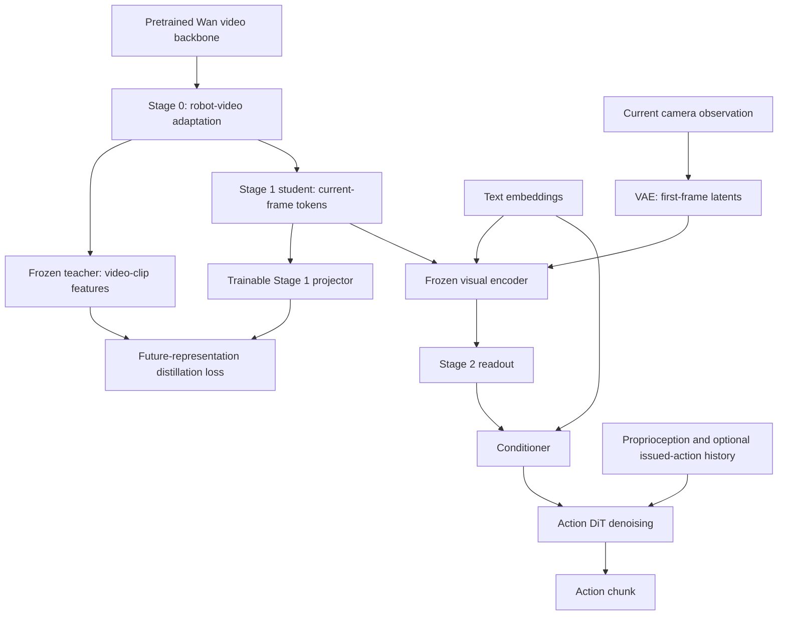

# Method and code map

DreamFree trains a visual encoder whose current-frame tokens carry information about future robot observations. At deployment, that encoder runs on the current observation and conditions an action diffusion transformer. Deployment does not roll out future video or run the Stage 1 teacher/projector.

## Training and inference

The bottom path, starting at the current observation, is also the deployed policy. The diagram shows component relationships; training still uses the full losses and masking rules below.

| Stage | Trainable components | Frozen components | Objective / output |
| --- | --- | --- | --- |
| 0 | Video DiT LoRA adapters | Pretrained backbone base, VAE, text encoder | Video flow matching; adapted teacher checkpoint |
| 1, LoRA | Student LoRA and projector | Stage 0 merged base, teacher path, VAE/text assets | Video flow matching plus representation distillation; student adapters and projector |
| 1, full | Student DiT and projector | Separate teacher DiT, VAE/text assets | Same two loss terms; full student weights and projector |
| 2 | Readout, conditioner/proprio encoder, action DiT | Stage 1 visual encoder and VAE/text assets | Masked action flow matching; action policy |

LIBERO/RoboCasa select LoRA Stage 1; DROID/ABC select full Stage 1. The [preset guide](../configs/README.md) specifies layers, noise distributions, attention settings, and action history. These choices are part of the experiment, not interchangeable speed settings.

## Stage 1: what is distilled

[DistillationModel.training_loss](../src/dreamfree/models/distillation.py) computes:

$$
L_{\mathrm{stage1}} = L_{\mathrm{video\ flow}} + \lambda L_{\mathrm{distillation}}.
$$

Here $\lambda$ is `distillation_loss_weight`. The teacher extracts hidden tokens from a video clip. The student's first-frame tokens feed `FirstFrameToTeacherStateProjector`, which predicts the teacher token layout. Selected recipes compare future tokens only. Distillation uses cosine distance after fixed tokenwise layer normalization; the teacher target is detached. The video flow-matching term also trains the student, with schedule weighting determined by its sigma policy.

LoRA mode shares the DiT base between teacher and student and switches adapter participation. Full mode owns a separate frozen teacher and computes its targets before retaining the student's autograd graph. Preserve these ownership rules when editing the model or distributed setup.

## Stage 2: projector versus readout

The **Stage 1 projector** learns the representation-distillation objective. It is saved for Stage 1 training/resume and is not used by the action policy.

The **Stage 2 readout** is a separate trainable latent-query module. It converts frozen current-frame visual tokens into a fixed number of action-conditioning tokens. The conditioner combines text and readout context, while a proprioceptive token and optional action-history tokens form the ActionDiT query prefix. The action model predicts flow velocity for a future action chunk. Padding masks remove padded targets from the loss.

The visual encoder receives exactly one latent frame during Stage 2 token extraction and deployment. The frozen boundary is enforced by [extract_current_only_student_tokens](../src/dreamfree/models/student.py) and [ActionTrainingModel](../src/dreamfree/models/action_training.py). Optimized inference additionally prepares attention projections, compiles blocks, and optionally captures CUDA graphs; those operations must retain the same conditioning and normalization semantics.

## Important tensor boundaries

`B` is batch size, `T` sampled video frames, `L` latent frames, `H/W` image size, `h/w` latent size, `N` first-frame patch tokens, `Q` readout queries, `A` action dimension, and `P` proprioceptive dimension. `D` is the video hidden width.

| Boundary | Shape / convention |
| --- | --- |
| Collated video | `(B, 3, T, H, W)`; dataset-composed, normalized pixels |
| Video latents | `(B, C, L, h, w)`; 5B uses `C=48`, 14B uses `C=16` |
| Current-frame latents | `(B, C, 1, h, w)` |
| Prepared text context / attention mask | `(B, 128, 4096)` / `(B, 128)`; `True` means attended position; cache readers return a full-length mask |
| Frozen visual tokens | `(B, N, D)`; `D=3072` for 5B, `D=5120` for 14B |
| Readout tokens | `(B, Q, action_hidden_dim)`; selected recipes use `Q=64` |
| Action / aligned proprio targets | `(B, action_horizon, A)` / `(B, action_horizon, P)`; normalized |
| Action/history padding masks | `(B, horizon)`; `True` means padding, opposite to a validity mask |

The text-cache readers zero padded embeddings and return a full-length attention mask, matching the trained DiT context convention. The batch builders preserve those tensors; do not replace that convention with token dropping. `prepare_distillation_batch` in the distillation model accepts one visual modality per batch. `prepare_action_batch` in [action_batch.py](../src/dreamfree/data/action_batch.py) also supports explicitly indexed, disjoint live/cached subsets and restores their target-row order. Cached training itself remains strict and does not switch to live inputs. Camera composition, action coordinate systems, and normalization vary by dataset; see [data contracts](data.md) and the dataset guides.

## Suggested reading order

1. [Configuration entrypoint](../src/dreamfree/config.py): public selectors, defaults, overrides, and stage dispatch.
2. [Stage 1 loop](../src/dreamfree/training/stage1/loop.py): preparation, model construction, optimization, and saving. Stage 0/2 follow the same layout.
3. [Distillation model](../src/dreamfree/models/distillation.py), then [future-state components](../src/dreamfree/models/wan22/future_state.py): teacher/student extraction, projector, and the two loss terms.
4. [Frozen student loading/extraction](../src/dreamfree/models/student.py) and [action training](../src/dreamfree/models/action_training.py): Stage 1 reuse and the Stage 2 loss.
5. [Policy assembly](../src/dreamfree/evaluation/policy.py): checkpoint-to-policy construction; follow the chosen benchmark adapter for observation conversion and rollout.
6. [Contract tests](../tests/test_contracts.py), [data-pipeline tests](../tests/test_data_pipeline.py), and [optimized-attention tests](../tests/test_optimized_attention.py): executable examples of the invariants.

Wan components and adapted LeRobot code are identified in [THIRD_PARTY.md](../THIRD_PARTY.md). Most experiments should begin in the stage configuration, model wrappers, or dataset adapters; changes to shared attention, normalization, or cache formats affect multiple stages and benchmarks.
